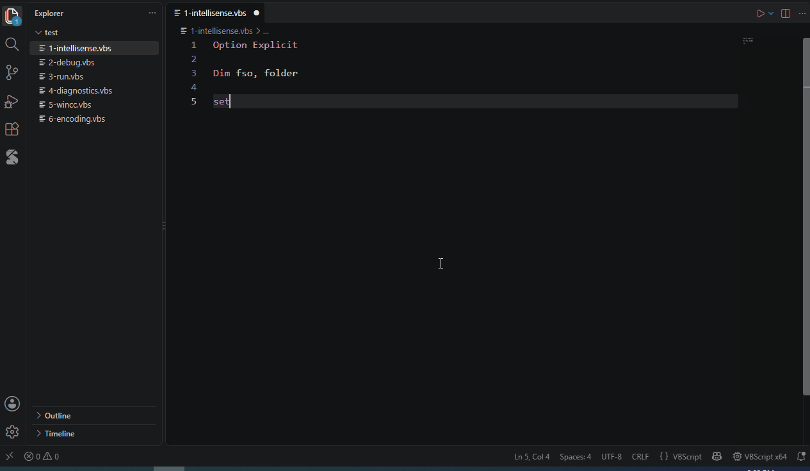
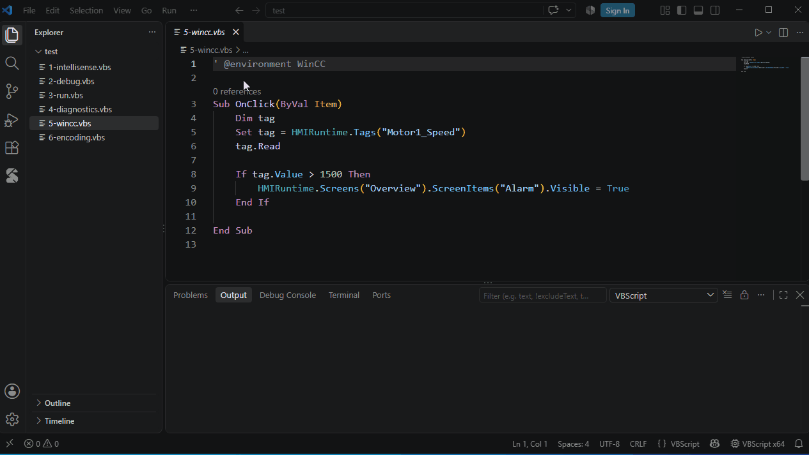
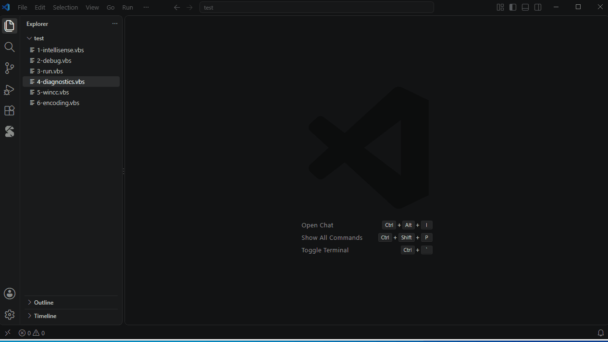
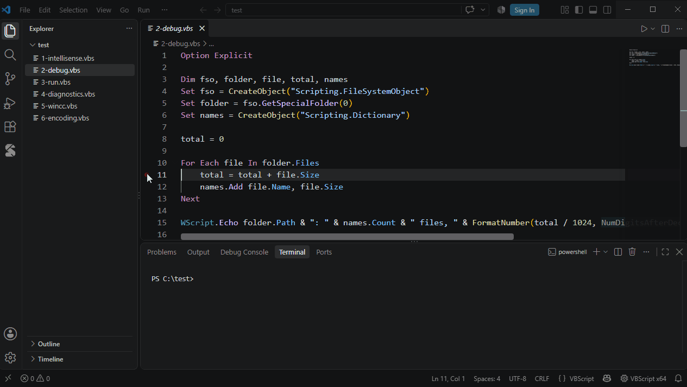
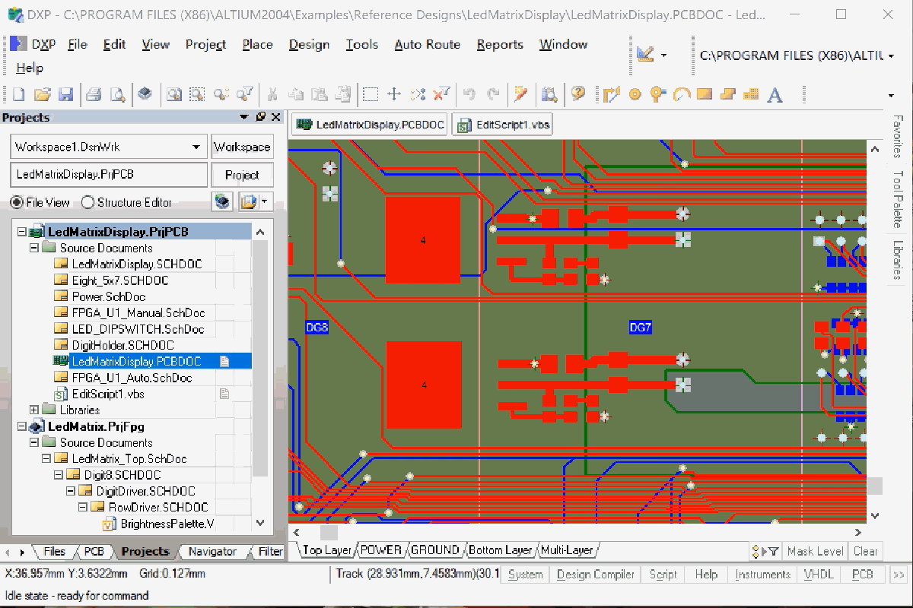
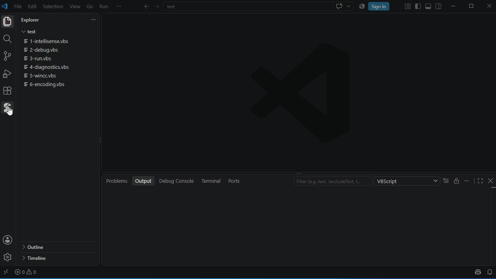
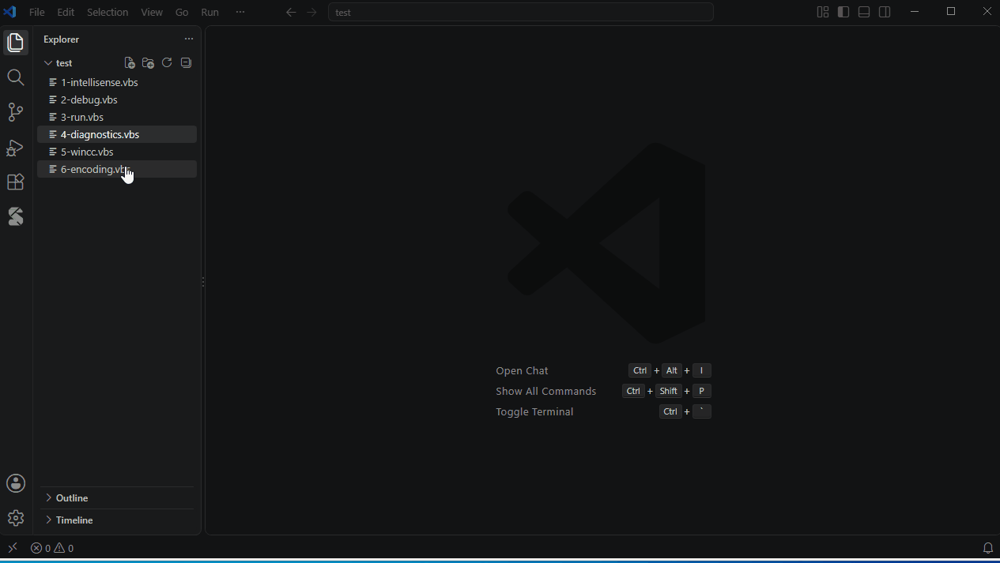

# VbsTools: VBScript for VS Code

**English** | [简体中文](#简体中文)

IntelliSense that understands COM objects, a debugger (also for scripts that run inside other applications), a
cscript-compatible script host and a code library for VBScript (`.vbs`).

> **Windows only.** Type information comes from the COM type libraries registered on your machine, and scripts
> run in the bundled script host. Syntax highlighting works everywhere.



## IntelliSense for COM objects

- `Set fso = CreateObject("Scripting.FileSystemObject")` → `fso.` lists its members; chains
  (`fso.GetFolder(p).Files.`), `For Each`, `With`, default members, script classes, function return types;
  names assigned without `Dim` (`x = 5`) complete too, local to their procedure or global at script level
- ProgID completion inside `CreateObject("…")`, parameter info, hover, parameter name hints
- **Applications that run VBScript inside them** (no registered type library): type definition files
  `*.vbstypes.json`. Built in: **WinCC V7/V8** — `"vbscript.environments": ["WinCC"]` or `' @environment WinCC`
  gives `HMIRuntime.Tags("x").Read`, `Item.` in event procedures, …; and **Altium DXP** (`' @environment Altium`:
  `PCBServer`, boards, iterators, `MkSet`, `eTopLayer`, …); your own files anywhere in the workspace
  are checked against a schema while you edit them (format: see the user guide); they can also describe the
  host's own global functions and constants
- **Type annotations** where inference cannot know the type: `' @type f As Scripting.File`,
  `' @param ws As Excel.Worksheet` and `' @returns Scripting.Folder` above a procedure
- **Included scripts**: `Include "lib\common.vbs"` (an `ExecuteGlobal` helper) or `' @include lib\common.vbs` —
  their procedures, classes and globals complete and are not reported as undefined; F12 and Ctrl+click open them



## Checks and navigation

- Syntax errors as you type (checked by vbscript.dll itself — the script is never run), `Option Explicit`
  warnings, calls to procedures that do not exist, wrong argument counts, unknown classes after `New`,
  unused variables; quick fixes (Ctrl+.) such as *Declare 'x' with Dim*
- Outline, go to definition (F12), find all references (Shift+F12), rename (F2) — including members of script
  classes used as `obj.Member` — call hierarchy (Shift+Alt+H), *N references* above procedures
- Semantic highlighting, Format Document (Shift+Alt+F) with optional keyword case normalization, folding by
  blocks and by `'#Region Name` … `'#End Region`



## Run and debug

- **Run Script** (Ctrl+F5, Shift+F5 stops): output in the *VBScript* panel, errors in the Problems panel; scripts
  that read `WScript.StdIn` run in a terminal. **Run / Debug with Arguments…** (Ctrl+Shift+F5) remembers the
  arguments per script. The status bar switches **x64 / x86**.
- **Debug** with F5 (no `launch.json` needed): breakpoints with conditions, hit counts and logpoints; step
  over / into / out; pause (also inside `WScript.Sleep`); call stack; variables (double-click to change a value);
  watch; hover; Debug Console with completion. "Runtime errors" and "Handled errors (On Error Resume Next)"
  in the Breakpoints view.
- **Debug engine** (`vbscript.debug.engine`, default `auto`): the debugger uses the **Process Debug Manager**
  (`pdm.dll`, installed with Visual Studio or Office) when it is available and instruments the script otherwise.
  With the Process Debug Manager a runtime error stops with the variables intact, loops without statements can be
  paused, the call stack is the engine's own, arrays, objects and Dictionaries are summarized (a Dictionary lists
  its `key = item` entries, an object its `[Methods]`), `Execute` / `ExecuteGlobal` code can be stepped into,
  `!retry` / `!skip` in the Debug Console run the failed statement again or move on past it, and *Jump to Cursor*
  moves the execution point.
- Scripts run in the bundled **VbsTools Script Host**, compatible with cscript (messages, exit codes,
  `WScript` object, COM events through `WScript.CreateObject(progId, "prefix_")` / `WScript.ConnectObject`),
  or in cscript itself (`vbscript.run.host`).



## Debug scripts that run inside another application

Some applications run VBScript with the Windows scripting engine and register their scripts for debugging —
**Altium DXP** is the case this was built for. A `"request": "attach"` configuration debugs those scripts
without starting them from VS Code:

```json
{ "type": "vbscript", "request": "attach", "name": "Attach to Altium DXP", "process": "DXP.exe" }
```



- Breakpoints, stepping, the call stack, variables, watch and the Debug Console work (Jump to Cursor does not). The objects the
  application gives to its scripts (`PCBServer`, `Board`, …) expand in the Variables view: their members come
  from the type files of the environment (built in for Altium DXP, or the `*.vbstypes.json` files of your
  workspace) and each value is read from the running application.
- **Attach first, then run the script** in the application: the breakpoints you set are bound when the script
  starts (`"stopOnEntry": true` also stops at its first statement). Attaching to a script that is **already
  running** does not stop it by itself: set breakpoints that are reached later, or press Pause. If the
  application already has a debugger of its own connected — Altium DXP connects one when a script starts — add
  `"takeOver": true` to disconnect it and connect VS Code instead.
- For an application that registers each run of a script, the session ends when the script ends. An application
  that stays registered, like Altium DXP, keeps the session so that the next script is caught; stop it when you
  are done.
- **One-time setup** (administrator; the extension ships none of these components): the Machine Debug Manager
  (`mdm.exe /regserver`), `pdm.dll` of the application's bitness (installed with Visual Studio or Office),
  membership of the *Debugger Users* group (sign out and in once), and the application started after that.
  **VBScript: Check Attach Debugging Environment** checks them, says what is missing and can register an
  `mdm.exe` you already have or add you to the group. The same check runs when the extension starts
  (`vbscript.attach.checkOnStartup`).
- If the attach does nothing, look in the Task Manager for a `DXP.exe` **without a window**: a closed application
  can leave a process that the Machine Debug Manager still lists but that does not answer. Each application gets
  5 seconds to answer; one that does not is skipped, and the message says how many were. End that process and
  try again.

Details and limits: [docs/DEBUGGER.md](https://github.com/ZachShen99/VbsTools/blob/master/docs/DEBUGGER.md).

## Code Library

The VbsTools icon in the activity bar opens the **Code Library**:

- **Samples** — VbsEdit's sample collection when VbsEdit is installed (or `vbscript.library.samplesFile`),
  otherwise the samples of VbsTools Studio. Preview, insert at the cursor, start a new script, copy to My Snippets.
- **My Snippets** — your snippets, each with a shortcut you type to insert it (checked against keywords and
  the other snippets). Edit a snippet in an editor and save with Ctrl+S; rename, move to a folder, delete.
  *Add to My Snippets…* in the editor context menu saves the selection. Shared with VbsTools Studio.

Built-in snippets (`fso`, `dict`, `fe`, `xl`, `wmi`, …) complete as usual.



## Settings you may want

| Setting | |
|---|---|
| `vbscript.run.platform` | `x64` or `x86` (COM components registered only for 32-bit) |
| `vbscript.run.host` | bundled VbsTools Script Host or cscript |
| `vbscript.environments` | host applications whose objects scripts use, e.g. `["WinCC"]` |
| `vbscript.inlayHints.parameterNames` | `none`, `literals` or `all` |
| `vbscript.format.keywordCase` | normalize keyword case when formatting |
| `vbscript.debug.engine` | `auto` (default), `instrumentation` or `pdm` — see *Run and debug* |
| `vbscript.typeFiles` | type definition files or folders besides the `*.vbstypes.json` files of the workspace |
| `vbscript.attach.checkOnStartup` | check the attach debugging environment when the extension starts |

## `.vbs` opens as "Visual Basic"?

VS Code's built-in Visual Basic support also claims `.vbs`. If the language mode shows "Visual Basic", add to
your settings:

```json
"files.associations": { "*.vbs": "vbscript" }
```

## File encodings

cscript and wscript read a `.vbs` file as UTF-16 LE (with BOM) or in the system ANSI code page — never as
UTF-8, which is what VS Code saves by default. So:

- ANSI scripts (GBK, Shift JIS, Windows-1252, …) that VS Code would show garbled are reopened with the
  system code page (`vbscript.encoding.ansi` to choose another)
- a script with Chinese, Japanese or accented text saved as UTF-8 runs correctly in VbsTools Script Host but
  prints garbled text in cscript / wscript: a warning offers *Save as UTF-16 LE* (runs everywhere) or
  *Save as ANSI*; **VBScript: Save with Encoding…** does the same at any time



## Documentation

**VBScript: Open Documentation** in the Command Palette opens the user guide (English, 简体中文): getting started,
editing, running, debugging, type definition files, Code Library, settings and FAQ.

## Interface languages

Commands, setting descriptions, messages, diagnostics and debugger messages are available in English, 简体中文, 繁體中文,
日本語, 한국어 and Deutsch, following the display language of VS Code (**Configure Display Language**). The user guide
is in English and 简体中文; in the other languages it opens in English.

## Feedback

Issues and suggestions: [github.com/ZachShen99/VbsTools/issues](https://github.com/ZachShen99/VbsTools/issues).

---

## 简体中文

[English](#vbstools-vbscript-for-vs-code) | **简体中文**

VBScript（`.vbs`）开发工具：能理解 COM 对象的智能提示、调试器（也能调试在其他软件内部运行的脚本）、兼容 cscript 的脚本宿主和代码库。

> **仅支持 Windows。** 类型信息来自本机注册的 COM 类型库，脚本在插件自带的脚本宿主中运行。语法高亮在任何系统上都可用。


### COM 对象的智能提示

- `Set fso = CreateObject("Scripting.FileSystemObject")` 之后输入 `fso.` 会列出它的成员；支持链式调用
  （`fso.GetFolder(p).Files.`）、`For Each`、`With`、默认成员、脚本中的类、函数返回值；没有用 `Dim` 声明、
  直接赋值的变量（`x = 5`）也会出现在补全中，作用域是所在过程，脚本顶层则是全局
- `CreateObject("…")` 中的 ProgID 补全、参数提示、悬停说明、参数名提示
- **在软件内部运行的脚本**（没有注册类型库）：用类型描述文件 `*.vbstypes.json` 描述对象。内置 **WinCC V7/V8** 和 **Altium DXP**（`' @environment Altium`：`PCBServer`、板、迭代器、`MkSet`、`eTopLayer` 等）：
  设置 `"vbscript.environments": ["WinCC"]` 或在脚本中写 `' @environment WinCC`，即可补全 `HMIRuntime.Tags("x").Read`、
  事件过程中的 `Item.` 等；工作区中自己编写的类型描述文件自动生效，编辑时按 Schema 校验；类型描述文件还可以描述
  宿主软件自己的全局函数和常量
- **类型注释**：推断不出类型时，用 `' @type f As Scripting.File`，或在过程上方写 `' @param ws As Excel.Worksheet`、
  `' @returns Scripting.Folder`
- **Include 文件**：`Include "lib\common.vbs"`（使用 `ExecuteGlobal` 的辅助过程）或 `' @include lib\common.vbs`——
  其中的过程、类和全局变量可以补全，不会报告为未定义；F12 和 Ctrl+单击可以打开


### 检查和导航

- 边输入边检查语法错误（由 vbscript.dll 检查，脚本不会被执行）、`Option Explicit` 下未声明的变量、调用不存在的过程、
  参数个数错误、`New` 后未定义的类、未使用的变量；快速修复（Ctrl+.），例如"用 Dim 声明 'x'"
- 大纲、转到定义（F12）、查找所有引用（Shift+F12）、重命名（F2，包括 `obj.Member` 形式的脚本类成员）、
  调用层次结构（Shift+Alt+H）、过程上方的引用计数
- 语义高亮、格式化文档（Shift+Alt+F，可统一关键字大小写）、按代码块和 `'#Region 名称` … `'#End Region` 折叠


### 运行和调试

- **运行脚本**（Ctrl+F5，Shift+F5 停止）：输出在 "VBScript" 面板，错误在"问题"面板；读取 `WScript.StdIn` 的脚本
  在终端中运行。**带参数运行 / 调试**（Ctrl+Shift+F5）按脚本记住参数。状态栏切换 **x64 / x86**。
- **调试**按 F5（不需要 `launch.json`）：条件断点、命中次数、日志点；单步跳过 / 进入 / 跳出；暂停（包括
  `WScript.Sleep` 中）；调用堆栈；变量（双击修改值）；监视；悬停；带补全的调试控制台。断点视图中可选
  "运行时错误"和"已处理的错误（On Error Resume Next）"。
- **调试引擎**（`vbscript.debug.engine`，默认 `auto`）：进程调试管理器（`pdm.dll`，随 Visual Studio 或 Office 安装）
  可用时，调试器使用它，否则在脚本中插入钩子。使用进程调试管理器时：运行时错误处停下并保留变量、可以暂停没有语句的
  循环、调用堆栈是引擎自己的、数组 / 对象 / Dictionary 会概括显示（Dictionary 列出 `key = item`，对象列出
  `[Methods]`）、可以单步进入 `Execute` / `ExecuteGlobal` 的代码、出错时在调试控制台输入 `!retry` / `!skip` 可以
  重新执行或跳过出错的语句，"跳转到光标处"可以移动执行位置。
- 脚本在自带的 **VbsTools 脚本宿主**中运行，与 cscript 兼容（消息、退出码、`WScript` 对象、通过
  `WScript.CreateObject(progId, "prefix_")` / `WScript.ConnectObject` 连接的 COM 事件），也可以改用 cscript
  （`vbscript.run.host`）。


### 调试在其他软件内部运行的脚本

有些软件用 Windows 脚本引擎运行 VBScript，并把脚本登记为可调试——**Altium DXP** 就是这个功能为之设计的场景。
用 `"request": "attach"` 配置，不必从 VS Code 启动脚本，就能调试它们：

```json
{ "type": "vbscript", "request": "attach", "name": "Attach to Altium DXP", "process": "DXP.exe" }
```


- 断点、单步、调用堆栈、变量、监视、调试控制台都可用（"跳转到光标处"除外）。软件交给脚本的对象（`PCBServer`、
  `Board` 等）可以在"变量"面板中展开：成员来自环境的类型描述文件（Altium DXP 内置，也可以是工作区里自己的
  `*.vbstypes.json`），每个值都从正在运行的软件中读取。
- **先附加，再在软件里运行脚本**：设置的断点在脚本启动时绑定（`"stopOnEntry": true` 还会停在脚本的第一条语句）。
  附加到一个**已经在运行**的脚本时，调试器不会自己停下：请在之后才会执行到的行设置断点，或者点"暂停"。如果软件
  上已经连着它自己的调试器（Altium DXP 在脚本启动时会连一个），在配置中加入 `"takeOver": true`，就会断开它并改连
  VS Code。
- 对于每次运行脚本才登记的软件，脚本结束时会话随之结束。像 Altium DXP 这样一直保持登记的软件，会话会保留，
  以便拦住下一个脚本；用完后请手动停止。
- **一次性准备**（需要管理员权限；扩展不附带这些组件）：机器调试管理器（`mdm.exe /regserver`）、与该软件位数相同的
  `pdm.dll`（随 Visual Studio 或 Office 安装）、加入 *Debugger Users* 用户组（加入后注销再登录一次），并在这之后启动
  该软件。**VBScript: Check Attach Debugging Environment** 会检查这些条件、告诉你缺什么，还可以注册你已有的
  `mdm.exe` 或把你加入用户组。扩展启动时也会做同样的检查（`vbscript.attach.checkOnStartup`）。
- 附加后没有反应时，请到任务管理器里找**没有窗口**的 `DXP.exe`：已经关闭的软件有时会留下一个进程，机器调试管理器
  仍然列着它，但它不回应。每个应用有 5 秒的时间回答，不回应的会被跳过，提示里会写明跳过了几个。结束那个进程再重试。

详细说明和限制：[docs/DEBUGGER.md](https://github.com/ZachShen99/VbsTools/blob/master/docs/DEBUGGER.md)。

### 代码库

点击活动栏中的 VbsTools 图标打开**代码库**：

- **示例**：安装了 VbsEdit 时显示 VbsEdit 的示例集（或用 `vbscript.library.samplesFile` 指定），否则显示
  VbsTools Studio 的示例。可以预览、插入到光标处、以此新建脚本、复制到我的代码片段。
- **我的代码片段**：自己的代码片段，每个都有快捷键，在脚本中输入即可插入（会检查是否与关键字和其他片段冲突）。
  在编辑器中修改并按 Ctrl+S 保存；可以重命名、移动到文件夹、删除。编辑器右键菜单中的"添加到我的代码片段…"
  可以保存选中的代码。与 VbsTools Studio 共用。

内置代码片段（`fso`、`dict`、`fe`、`xl`、`wmi` 等）照常可用。


### 常用设置

| 设置 | |
|---|---|
| `vbscript.run.platform` | `x64` 或 `x86`（只注册了 32 位的 COM 组件） |
| `vbscript.run.host` | 自带的 VbsTools 脚本宿主或 cscript |
| `vbscript.environments` | 脚本使用其对象的宿主软件，例如 `["WinCC"]` |
| `vbscript.inlayHints.parameterNames` | `none`、`literals` 或 `all` |
| `vbscript.format.keywordCase` | 格式化时统一关键字大小写 |
| `vbscript.debug.engine` | `auto`（默认）、`instrumentation` 或 `pdm`，见"运行和调试" |
| `vbscript.typeFiles` | 工作区中的 `*.vbstypes.json` 之外，另外指定的类型描述文件或文件夹 |
| `vbscript.attach.checkOnStartup` | 扩展启动时检查附加调试所需的环境 |

### `.vbs` 被识别为 "Visual Basic"？

VS Code 自带的 Visual Basic 支持也会认领 `.vbs`。语言模式显示 "Visual Basic" 时，在设置中加入：

```json
"files.associations": { "*.vbs": "vbscript" }
```

### 文件编码

cscript 和 wscript 只能按带 BOM 的 UTF-16 LE 或系统 ANSI 代码页读取 `.vbs` 文件，不认识 VS Code 默认保存的 UTF-8。因此：

- VS Code 会显示成乱码的 ANSI 脚本（GBK、Shift JIS 等）会按系统代码页重新打开（用 `vbscript.encoding.ansi` 指定其他代码页）
- 含中文、日文等字符的 UTF-8 脚本在 VbsTools 宿主中运行正常，但在 cscript / wscript 中会乱码：警告处可以选择
  "另存为 UTF-16 LE"（任何系统都能运行）或"另存为 ANSI"；随时也可以执行 **VBScript: 以指定编码保存…**


### 使用说明

在命令面板中执行 **VBScript: 打开说明文档**，可以查看完整的使用说明（中文 / English）：快速上手、编辑、运行、调试、
类型描述文件、代码库、设置和常见问题。

### 界面语言

命令、设置说明、提示信息、诊断信息和调试器消息有 English、简体中文、繁體中文、日本語、한국어、Deutsch 六种语言，
跟随 VS Code 的显示语言（**Configure Display Language**）。使用说明只有中文和英文；其他语言显示英文。

### 反馈

问题和建议：[github.com/ZachShen99/VbsTools/issues](https://github.com/ZachShen99/VbsTools/issues)。
