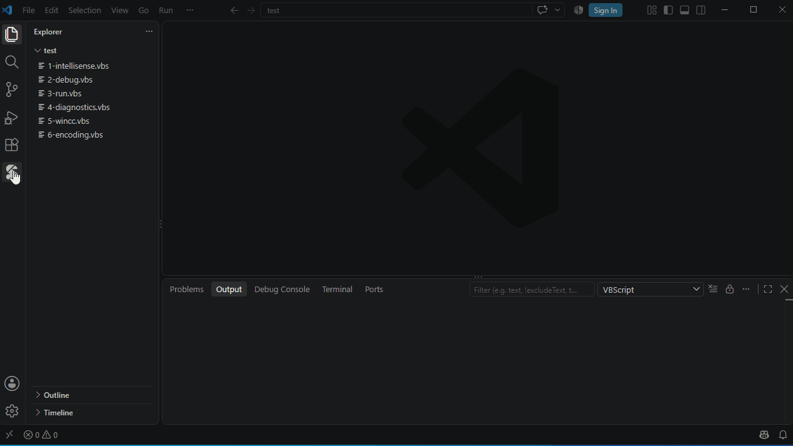

# Code Library

The VbsTools icon in the activity bar opens the Code Library, with two groups.

## Samples

- With VbsEdit installed: VbsEdit's sample collection (about 1,700 samples by topic). The extension looks for `samples2.dat` / `samples.dat` in the VbsEdit installation folder; elsewhere, set `vbscript.library.samplesFile`.
- Without VbsEdit: the samples of VbsTools Studio.

Click a sample to preview it. Context menu and inline buttons:

| Action | Description |
|---|---|
| Insert at Cursor | Inserts it at the cursor of the active editor |
| New Script from This | A new script with the sample's code |
| Copy to My Snippets… | Saves it as your own snippet, to change it and insert it with a shortcut |

🔍 in the view's title bar searches names and contents of samples and snippets.

## My Snippets

Your own snippets, each with a **shortcut**: type the shortcut in a script and choose it from the suggestions (or press Tab).

| Action | How |
|---|---|
| New | ＋ in the view's title bar, or right-click a folder; enter a name, a shortcut and a folder |
| From selected code | Select code in the editor, right-click → **Add to My Snippets…** |
| Edit the code | Right-click → Edit Snippet; change it in the editor and save with Ctrl+S |
| Change shortcut / Rename / Move to folder / Delete | Context menu |

A shortcut is letters, digits and `_` (starting with a letter) and must not be a VBScript keyword, a built-in snippet (`fso`, `dict`, …) or another snippet's shortcut — checked as you type.

`${1:name}` in the code marks a placeholder: after inserting, the cursor is there; Tab moves to the next one.

Snippets are stored in `%APPDATA%\VbsTools\snippets.json`, shared with VbsTools Studio. **…** in the view's title bar → **Open My Snippets File (JSON)** opens it, e.g. to back it up or copy it to another computer.
