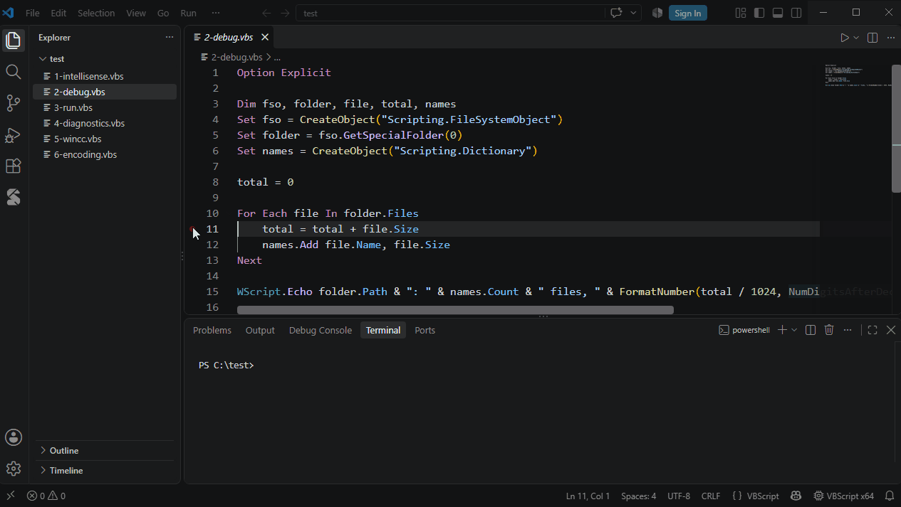

# Debugging



Open a script and press **F5** — no `launch.json` is needed. The script runs in the VbsTools Script Host, with the same platform (x64 / x86) and arguments as *Run Script*.

## Breakpoints

| Kind | How |
|---|---|
| Breakpoint | Click left of the line number, or F9 |
| Conditional | Right-click the breakpoint → Edit Breakpoint → Expression, e.g. `i > 10 And name = "abc"` |
| Hit count | Edit Breakpoint → Hit Count: `5` (5th hit), `>= 5`, `> 5`, `< 5`, `<= 5`, `% 5` (every 5th) |
| Logpoint | Edit Breakpoint → Log Message, e.g. `i = {i}, name = {name}`: does not stop, writes the message to the Debug Console |

A breakpoint on a line without executable code (`Dim`, `End If`, a blank line) moves to the next statement.

## Stepping

| Action | Shortcut |
|---|---|
| Continue | F5 |
| Step over | F10 |
| Step into | F11 |
| Step out | Shift+F11 |
| Pause | F6 (also while the script waits in `WScript.Sleep`) |
| Stop | Shift+F5 |

## Values

- **Variables** view: locals and globals. Strings in quotes; `Empty` / `Null` / `Nothing` as such; arrays as `Variant(0 To 3)` with their elements; COM objects with their properties from type information; objects of script classes with public fields and `Property Get` (methods are never called); Dictionaries as key → value.
- **Change a value**: double-click a variable and enter a value or an expression (evaluated in the current scope; objects are assigned with `Set`).
- **Watch**: any expression, evaluated at every stop.
- **Hover**: a variable's value while stopped.
- `Err`, `Err.Number` and `Err.Description` in watches and conditions show the script's own error state.

## Debug Console

While stopped, the Debug Console works like VB's Immediate window:

| Input | Effect |
|---|---|
| `? x * 2` | Evaluates and shows the result |
| `x = 5` | Runs the assignment |
| `Call Foo(1)` | Runs the statement |
| Anything else | Evaluated as an expression |

Completion works as in the editor, COM objects included.

The script's output (`WScript.Echo`, `StdOut`, `StdErr`) appears in the Debug Console too, `StdErr` in red. A script that uses `WScript.StdIn` runs in a terminal instead so that you can type; breakpoints and stepping work as usual.

## Exceptions

Two options in the Breakpoints view:

| Option | Default | Stops |
|---|---|---|
| Runtime errors | On | On the line of an unhandled runtime error |
| Handled errors (On Error Resume Next) | Off | On the line of an error that occurs while `On Error Resume Next` is active |

When stopped on an unhandled error, the engine has already left the statement: the call stack is shown, values are not.

## COM events

Events connected with `WScript.CreateObject("ProgID", "prefix_")` and `WScript.ConnectObject` fire while debugging, and breakpoints in event handlers work. Events that arrive while the script is stopped are queued and delivered when it continues.

## launch.json

For fixed arguments or other options, add a configuration to `.vscode/launch.json` (type `VBScript` in that file for snippets):

```jsonc
{
  "version": "0.2.0",
  "configurations": [
    {
      "type": "vbscript",
      "request": "launch",
      "name": "Debug VBScript",
      "program": "${file}",
      "args": ["in.txt", "/verbose"],     // WScript.Arguments
      "cwd": "${fileDirname}",            // working directory
      "platform": "x86",                  // x64 / x86, default: vbscript.run.platform
      "stopOnEntry": false,               // stop at the first statement
      "console": "integratedTerminal"     // internalConsole / integratedTerminal / externalTerminal
    }
  ]
}
```

Without `console`, `vbscript.run.console` decides: a terminal when the script uses `WScript.StdIn`, otherwise the Debug Console.

## Limits

- Stepping is per line; several statements on one line (`a = 1: b = 2`) run at once.
- A loop without statements (`Do : Loop`) cannot be paused.
- `.wsf` and `.vbe` files are not supported.
