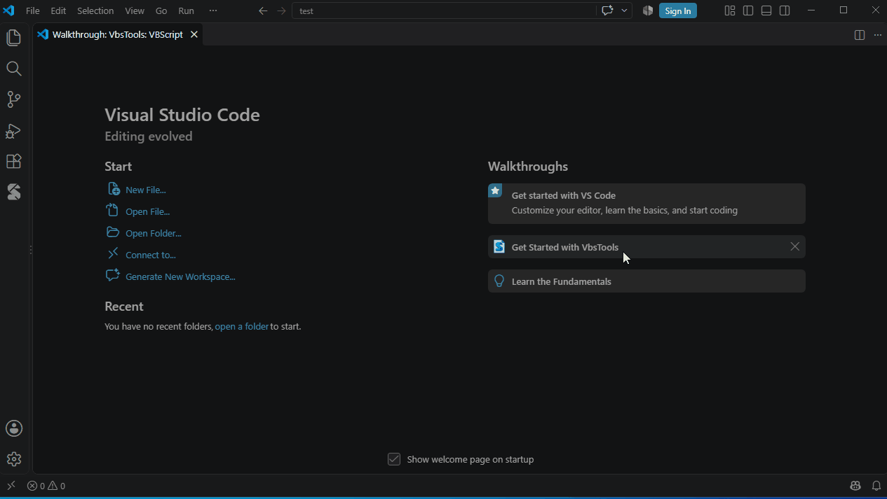

# Getting started

## Installing

1. In VS Code, open the Extensions view (Ctrl+Shift+X), click **…** at the top → **Install from VSIX…** and choose `vbstools-vbscript-*.vsix`.
   Or from a command line:

   ```powershell
   code --install-extension .\vbstools-vbscript-win32-x64-0.2.0.vsix
   ```

2. Run **Developer: Reload Window** (Ctrl+Shift+P).
3. To reinstall the same version, add `--force`.

The language server and the script host (x64 / x86) are included; nothing else (such as .NET) needs to be installed.

## Walkthrough

The **Get Started with VbsTools** page (**Help → Welcome**, under Walkthroughs) takes you through a sample script, running, debugging, the Code Library, host environments and this guide — each step with a button that does it.



## A first script

1. Create a file and save it as `hello.vbs`. The language mode in the status bar should read **VBScript**.
   If it reads "Visual Basic", see the [FAQ](faq.md#vbs-files-open-as-visual-basic).
2. Type:

   ```vbscript
   Option Explicit

   Dim fso, folder
   Set fso = CreateObject("Scripting.FileSystemObject")
   Set folder = fso.GetFolder("C:\Windows")
   WScript.Echo folder.Files.Count & " files"
   ```

   `fso.` lists the members of FileSystemObject; `CreateObject("` lists the ProgIDs registered on your machine.
3. Press **Ctrl+F5** to run it. The output appears in the *VBScript* output panel; an error appears in the Problems panel and the cursor moves to its line.
4. Put a breakpoint on the `WScript.Echo` line with **F9** and press **F5** to debug. When it stops, expand `folder` in the Variables view to see its properties.

## Status bar

With a `.vbs` file open, the status bar shows **VBScript x64** or **VBScript x86**. Click it to switch between 64-bit and 32-bit. COM components registered for 32-bit only (some older Office add-ins, database drivers) need x86.

## Next steps

- [Editing and IntelliSense](editing.md): completion, diagnostics and quick fixes in detail
- [Running scripts](running.md): arguments, the two hosts, file encodings
- [Debugging](debugging.md)
- Scripts that run inside an application such as WinCC: [Type definitions and annotations](type-files.md)
