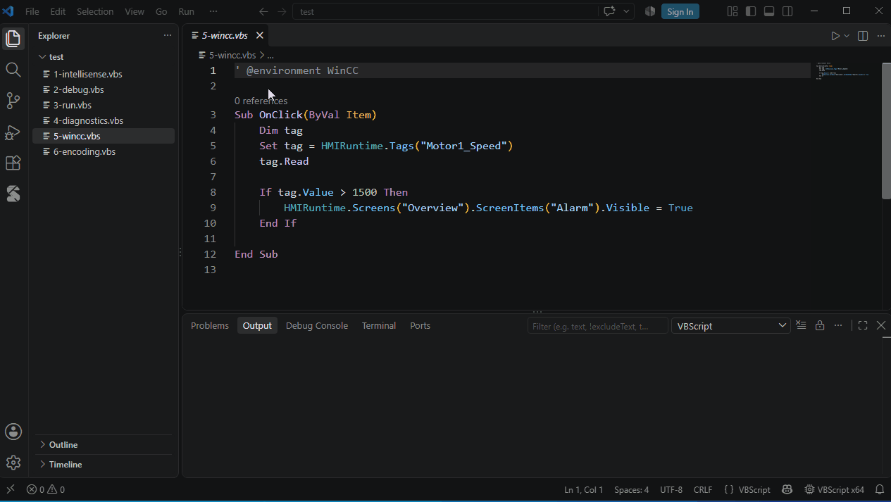

# Type definitions and annotations

Besides COM type libraries, there are three ways to tell the extension the type of an object: host environments (type definition files), type annotations and included scripts.

## Host environments: WinCC

Some scripts run inside an application that adds global objects (such as WinCC's `HMIRuntime`). Those objects have no registered type library; a type definition file (`*.vbstypes.json`) describes them. **WinCC V7 / V8 (classic)** is built in.

Turn it on in one of two ways:

- For every script: the setting `"vbscript.environments": ["WinCC"]`
- For one script: the comment `' @environment WinCC` in it

Then:

```vbscript
' @environment WinCC
Sub OnClick(ByVal Item)
    Item.                                   ' properties of the screen object
    HMIRuntime.Tags("Motor1").Read          ' tag object
    HMIRuntime.Screens("Base").ScreenItems("Button1").Visible = False
End Sub
```



The built-in WinCC definitions were made from the WinCC VBS reference; a member may differ in your version. Add what is missing in a type definition file of your own in the workspace.

## Writing type definition files

Every `*.vbstypes.json` in the workspace applies to all scripts and is reloaded when saved. Files outside the workspace: the setting `vbscript.typeFiles` (files or folders; environment variables such as `%USERPROFILE%` work). The editor checks the file against a JSON schema and completes it; errors appear in the Problems panel.

```jsonc
{
  "name": "Demo",                                  // required: the environment name
  "description": "Demo application",
  "globals":    { "App": "Application" },          // global objects: name → type
  "parameters": { "Item": "Control" },             // types of procedure parameters by name (event procedures)
  "progIds":    { "Demo.Counter": "Counter" },     // the type CreateObject("Demo.Counter") returns
  "enums":      { "Mode": { "Fast": 1, "Safe": 2 } },
  "types": {
    "Application": {
      "description": "Root object",
      "members": {
        "Version": "String",                        // a string: a property of that type
        "Items":   { "type": "Items", "readonly": true, "doc": "All items" },
        "Log":     { "kind": "method", "params": [ { "name": "Text", "type": "String" } ] },
        "Run":     { "kind": "method", "type": "Long",               // a method with a type is a Function
                     "params": [ { "name": "Name", "type": "String" },
                                 { "name": "Mode", "type": "Mode", "default": 1 } ] }
      }
    },
    "Items": {
      "element": "Item",                            // element type of For Each
      "members": {
        "Item":  { "type": "Item", "default": true, "params": [ { "name": "Index", "type": "Variant" } ] },
        "Count": "Long"
      }
    },
    "Item":    { "open": true, "members": { "Name": "String" } },     // open: has members not listed
    "Counter": { "members": { "Value": "Long" } },
    "Control": { "members": { "Visible": "Boolean" } }
  }
}
```

- **Type names**: VBScript types (`Variant String Long Integer Boolean Double Single Date Currency Byte Object`), types and enums of the file, or `progid:Excel.Application` (a registered COM type).
- **Members**: `kind` is `property` (default) or `method`; `default: true` marks the default member (`obj("x")` calls it); parameters can be `optional`, have a `default` (which makes them optional) or be a `paramArray`.
- **Enums**: used as the type of a parameter or property, completion lists their values and inserts the number (VBScript does not know the names at run time).
- Comments and trailing commas are allowed.

## Type annotations

Where the extension cannot infer a type (an object passed as a parameter, for instance), a comment gives it:

```vbscript
' @type f As Scripting.File
For Each f In files
    f.                          ' members of File
Next

' @param ws As Excel.Worksheet
' @returns Scripting.Folder
Function Export(ws)
    ws.                         ' members of Worksheet
    Set Export = CreateObject("Scripting.FileSystemObject").GetFolder("C:\")
End Function

Export(sheet).                  ' members of Folder
```

| Comment | Where | Gives |
|---|---|---|
| `' @type variable As Type` | Anywhere in the scope of the variable | The variable's type |
| `' @param parameter As Type` | Comment block right above the Sub / Function | A parameter's type |
| `' @returns Type` | Comment block right above the Function / Property Get | The return type |

`As` is optional. A type is a ProgID (`Scripting.FileSystemObject`), `Library.Type` of a registered type library (`Excel.Worksheet`, `Scripting.File`), a class of the script, or a type of the active host environment. An unknown type name is reported.

## Included scripts

VBScript has no include statement; scripts read another file and run it with `ExecuteGlobal`:

```vbscript
Include "lib\common.vbs"

Sub Include(path)
    Dim fso
    Set fso = CreateObject("Scripting.FileSystemObject")
    ExecuteGlobal fso.OpenTextFile(fso.BuildPath(fso.GetParentFolderName(WScript.ScriptFullName), path)).ReadAll
End Sub
```

The extension recognizes these forms and reads the included file: its procedures, classes and globals complete and are not reported as undefined; F12 and Ctrl+click open them.

- A call with a string literal to a procedure of the script that has a parameter and uses `ExecuteGlobal`
- A call with a string literal to a procedure named `Include`, `IncludeFile`, `IncludeScript` or `Import`
- The comment `' @include lib\common.vbs` (the path may be quoted)

Relative paths start at the **folder of the script**. A file that is not found is reported. Scripts included by included scripts are read too (up to 4 levels).
