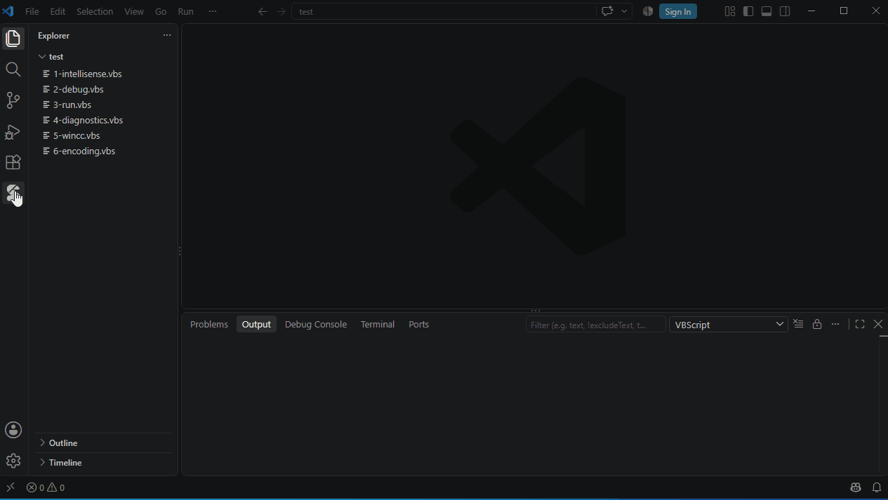

# 代码库

点击活动栏中的 VbsTools 图标打开"代码库"视图，里面有两组内容。

## 示例

- 安装了 VbsEdit 时，显示 VbsEdit 自带的示例集（约 1700 个，按主题分类）。插件在 VbsEdit 安装目录中查找 `samples2.dat` / `samples.dat`；放在其他位置时用设置 `vbscript.library.samplesFile` 指定。
- 没有安装 VbsEdit 时，显示 VbsTools Studio 自带的示例。

单击示例可以预览。右键或行尾按钮：

| 操作 | 说明 |
|---|---|
| 插入到光标处 | 插入到当前编辑器的光标位置 |
| 以此新建脚本 | 用示例内容新建一个脚本 |
| 复制到我的代码片段… | 保存为自己的代码片段，方便修改和用快捷键插入 |

视图标题栏的 🔍 可以按名称和内容搜索示例和代码片段。

## 我的代码片段

自己的代码片段，每个都有一个**快捷键**：在脚本中输入快捷键，从补全列表中选择（或按 Tab）即可插入。

| 操作 | 方法 |
|---|---|
| 新建 | 视图标题栏的 ＋，或右键文件夹；依次输入名称、快捷键、文件夹 |
| 从选中的代码新建 | 在编辑器中选中代码，右键 → **添加到我的代码片段…** |
| 编辑内容 | 右键 → 编辑代码片段，在编辑器中修改后按 Ctrl+S 保存 |
| 修改快捷键 / 重命名 / 移动到文件夹 / 删除 | 右键菜单 |

快捷键只能由字母、数字和 `_` 组成（以字母开头），并且不能与 VBScript 关键字、内置代码片段（`fso`、`dict` 等）或其他代码片段重复，输入时会立即检查。

在内容中写 `${1:name}` 表示占位符：插入后光标停在这里，按 Tab 跳到下一个。

代码片段保存在 `%APPDATA%\VbsTools\snippets.json`，与 VbsTools Studio 共用。视图标题栏的 **…** → **打开我的代码片段文件 (JSON)** 可以直接编辑这个文件，比如备份或复制到其他电脑。
