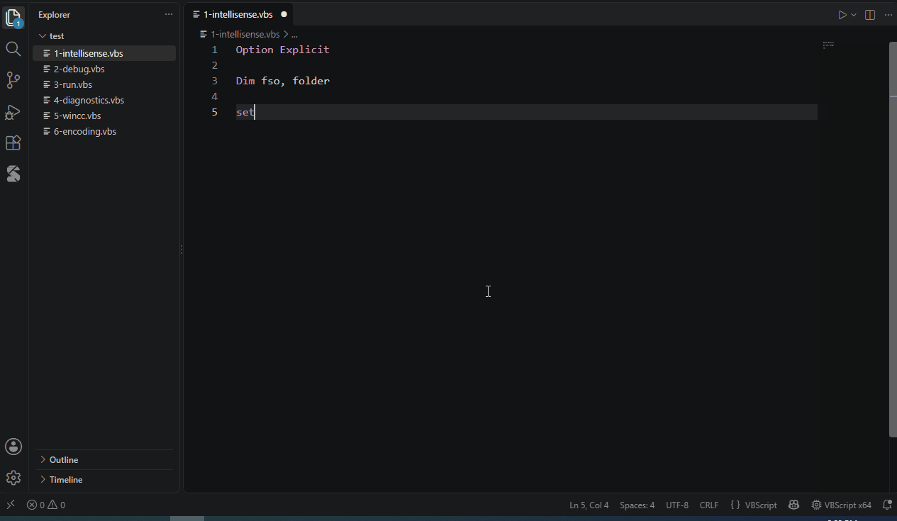
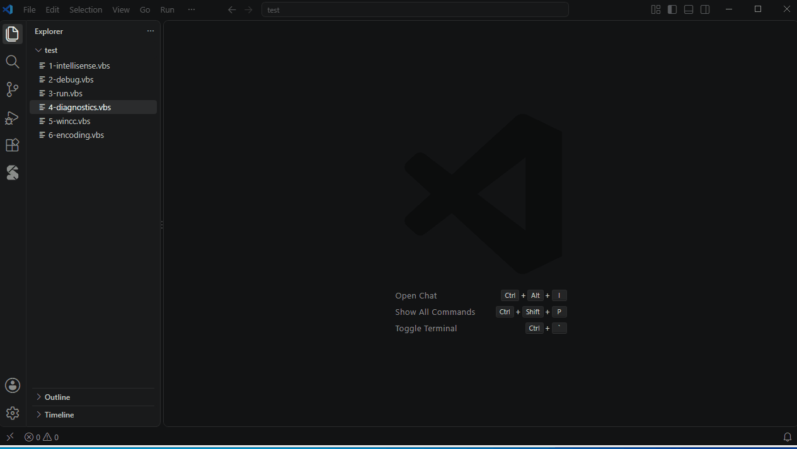

# 编辑与智能提示

## COM 对象的智能提示



插件从本机注册的 COM 类型库读取对象的成员，并根据代码推断变量的类型：

```vbscript
Set fso = CreateObject("Scripting.FileSystemObject")
fso.                                ' FileSystemObject 的成员
fso.GetFolder("C:\").Files.         ' 链式调用：Files 集合的成员
For Each f In fso.GetFolder("C:\").Files
    f.                              ' For Each 的元素类型：File
Next
With fso.GetFile("a.txt")
    .                               ' With 块
End With
```

能推断的来源包括：`CreateObject` / `GetObject` / `WScript.CreateObject`、`Set x = …` 赋值、函数返回值、`For Each` 的元素类型、`With` 块、默认成员（`dict("key").`）、脚本中定义的类（`Set p = New Person`）。

| 功能 | 说明 |
|---|---|
| ProgID 补全 | 在 `CreateObject("` 中列出本机注册的 ProgID |
| 参数提示 | 输入 `(` 或 `,` 时显示参数列表，并高亮当前参数 |
| 悬停 | 鼠标停在成员或变量上，显示签名和说明 |
| 参数名提示 | 调用处显示参数名，例如 `fso.OpenTextFile("a.txt", IOMode: 8, Create: True)`；见设置 `vbscript.inlayHints.parameterNames` |
| 枚举值 | 参数为枚举类型时，补全列出可选值；选择后插入数值，因为 VBScript 运行时不认识类型库里的常量名 |
| 内置函数和对象 | `MsgBox`、`InStr` 等 VBScript 函数，以及 `WScript`、`WScript.StdIn` / `StdOut`、`Err` |

推断不出类型时（例如作为参数传进来的对象），可以用注释标明类型，见[类型描述与注释](type-files.md#类型注释)。

## 代码片段

输入缩写后从补全列表中选择（或按 Tab）即可插入：

`fso` `dict` `shell` `net` `readfile` `writefile` `xl` `word` `fe` `for` `if` `ife` `sel` `do` `func` `sub` `cls` `wmi` `oe` `http` `ado` `args`

也可以定义自己的代码片段和快捷键，见[代码库](code-library.md)。

## 错误检查

边输入边检查，脚本不会被执行：



| 检查 | 级别 |
|---|---|
| 语法错误（由 vbscript.dll 检查，提示文字与系统语言一致） | 错误 |
| `Option Explicit` 下未声明的变量 | 警告 |
| 调用不存在的 Sub / Function | 警告 |
| 参数个数不对 | 警告 |
| `New` 后面是未定义的类 | 警告 |
| 未使用的变量（显示为灰色） | 提示 |
| 找不到 Include 的文件、类型注释中的未知类型 | 警告 |
| 文件编码会让 cscript 读错（见[运行脚本](running.md#文件编码)） | 警告 |

### 快速修复（Ctrl+.）

- 用 `Dim` 声明未声明的变量，或一次声明全部
- 删除未使用的变量
- 把文件另存为 UTF-16 LE / ANSI（编码警告）

## 导航

| 功能 | 操作 |
|---|---|
| 大纲 | 资源管理器中的"大纲"视图，或 Ctrl+Shift+O |
| 转到定义 | F12 或 Ctrl+单击；也能跳到 Include 文件中的定义 |
| 查找所有引用 | Shift+F12 |
| 重命名 | F2；脚本类的成员在 `obj.Member` 处也会一起改名 |
| 调用层次结构 | Shift+Alt+H |
| 引用计数 | 过程和类上方显示 *N 个引用*，点击列出；可用 `vbscript.codeLens.references` 关闭 |
| 语义高亮 | 变量、参数、过程、类、COM 成员和宿主对象使用不同颜色 |

## 格式化和折叠

- **格式化文档**（Shift+Alt+F）：调整缩进。默认同时把关键字和内置名称改成常用写法（`End If`、`MsgBox`、`vbCrLf`），脚本中定义的名称统一成声明时的写法。只想调整缩进时，把 `vbscript.format.keywordCase` 设为 `preserve`。
- **折叠**：按代码块（`If`、`For`、`Sub`、`Class` 等）折叠，也可以用区域注释：

  ```vbscript
  '#Region 初始化
  ...
  '#End Region
  ```

  区域名称还会显示在编辑器右侧的缩略图中。
