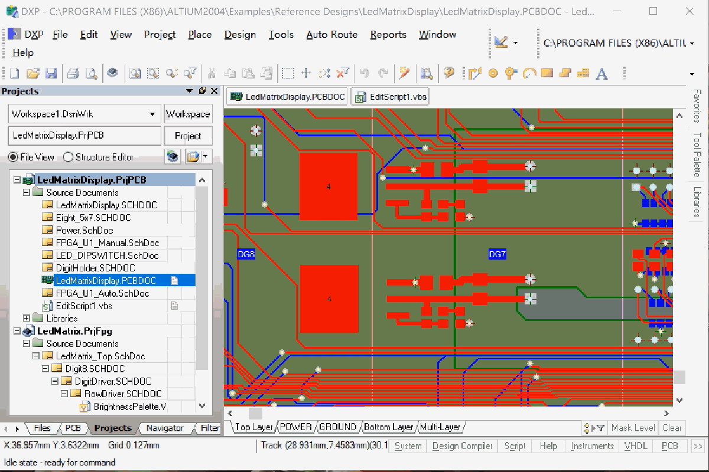

# Debug scripts inside another application



Some applications (Altium DXP, for example) run VBScript themselves. VS Code can **attach** to them and debug those scripts — breakpoints, stepping, variables and the Debug Console.

**1. One-time setup.** Run **VBScript: Check Attach Debugging Environment** (the link on the left). It checks three things and can fix two of them for you:

- the **Process Debug Manager** (`pdm.dll`) — it comes with Visual Studio or Office; this extension does not include it
- the **Machine Debug Manager** (`mdm.exe`) — the *Register this mdm.exe* button picks the Microsoft-signed one from your installation and registers it (asks for administrator rights)
- membership of the **Debugger Users** group — *Add me to the group...* does it; **sign out of Windows and in again** once afterwards

**By hand instead** — in a Command Prompt **run as administrator**:

```bat
:: Machine Debug Manager: register it (it also installs the Windows service "MDM").
:: Use the Microsoft-signed mdm.exe of your Visual Studio / Office installation, version 7.0 or later.
"C:\path\to\mdm.exe" /regserver

:: Debugger Users group: create it if the computer has none, then add yourself.
net localgroup "Debugger Users" /add
net localgroup "Debugger Users" %USERNAME% /add
```

Then **sign out of Windows and in again**. `pdm.dll` is usually in `C:\Program Files (x86)\Common Files\Microsoft Shared\VS7Debug`; it needs no registration here. To undo the registration: `mdm.exe /unregserver`. To check it: `sc query MDM` (should say RUNNING or STOPPED, not "does not exist") and `net localgroup "Debugger Users"` (your name is in the list).

**2. Add a configuration.** Open `launch.json` (the second link) and add:

```json
{ "type": "vbscript", "request": "attach", "name": "Attach to Altium DXP", "process": "DXP.exe" }
```

**3. Attach, then run.** Start the application *after* the setup, press **F5** with this configuration, then run the script in the application. Breakpoints you set are bound when the script starts.

- A script that is **already running** is not stopped by attaching: use a breakpoint that is reached later, or press Pause.
- Altium DXP connects a debugger of its own when a script starts. If the attach says another debugger is connected, add `"takeOver": true`.
- Nothing happens? Look in the Task Manager for a `DXP.exe` **without a window** and end it.
