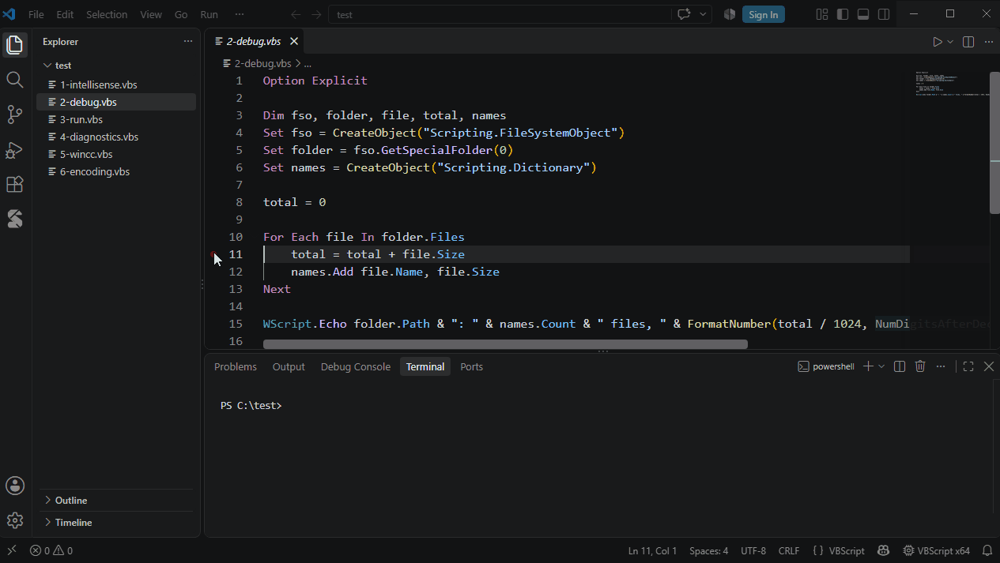

# Debugging

| | |
|---|---|
| **F9** | Toggle breakpoint |
| **F5** | Start / continue |
| **F10 / F11 / Shift+F11** | Step over / into / out |
| **F6** | Pause (also inside `WScript.Sleep`) |

- **Variables**: locals and globals, arrays, COM objects, Dictionaries — double-click to change a value
- **Watch** and hover show values while stopped
- **Debug Console**: `? expr` evaluates, `x = 5` assigns — with completion
- Right-click a breakpoint for a condition, a hit count or a log message
- No `launch.json` needed
