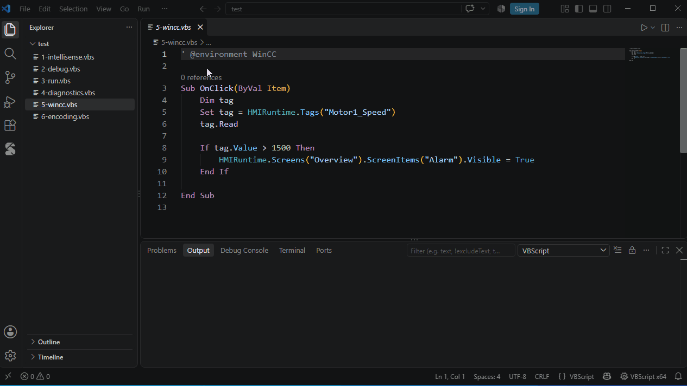

# Scripts inside applications



WinCC and other applications add their own objects to scripts. With the **WinCC** environment turned on:

```vbscript
Sub OnClick(ByVal Item)
    Item.                                  ' the screen object
    HMIRuntime.Tags("Motor1").Read
End Sub
```

Turn it on for every script:

```json
"vbscript.environments": ["WinCC"]
```

or for one script with the comment `' @environment WinCC`.

Other applications: describe their objects in a `*.vbstypes.json` file in the workspace. Where a type cannot be inferred, a comment gives it: `' @type ws As Excel.Worksheet`.
