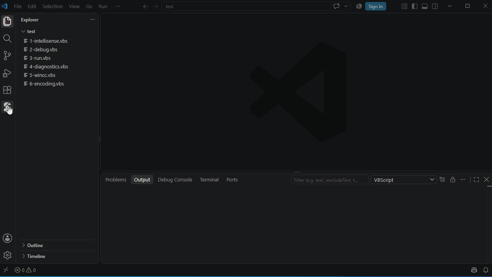

# Code Library

**Samples** — VbsEdit's sample collection when VbsEdit is installed, otherwise the samples of VbsTools Studio:

- click to preview, **Insert at Cursor**, **New Script from This**
- 🔍 searches names and contents

**My Snippets** — your own code, each with a shortcut:

- type the shortcut in a script and choose it from the suggestions
- select code, right-click → **Add to My Snippets…**
- edit a snippet in an editor, save with **Ctrl+S**
- `${1:name}` marks a placeholder
