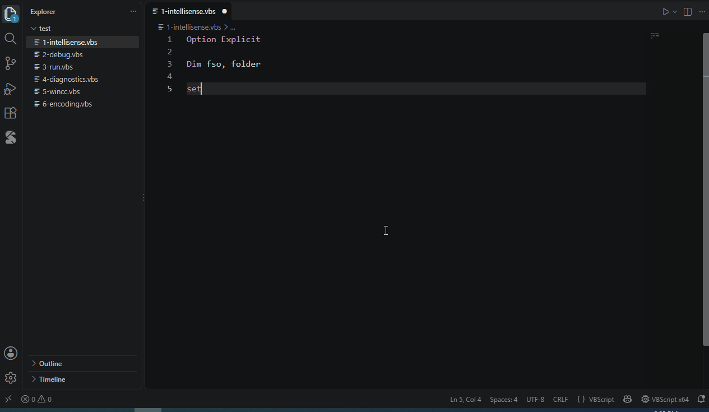

# IntelliSense for COM objects



```vbscript
Set fso = CreateObject("Scripting.FileSystemObject")
fso.                               ' members of FileSystemObject
fso.GetFolder("C:\").Files.        ' chains
For Each f In fso.GetFolder("C:\").Files
    f.                             ' element type of For Each: File
Next
```

- `CreateObject("` lists the ProgIDs registered on this computer
- `(` and `,` show the parameters; hover shows the documentation
- Warnings for undeclared variables, unknown procedures and wrong argument counts, with quick fixes (**Ctrl+.**)
