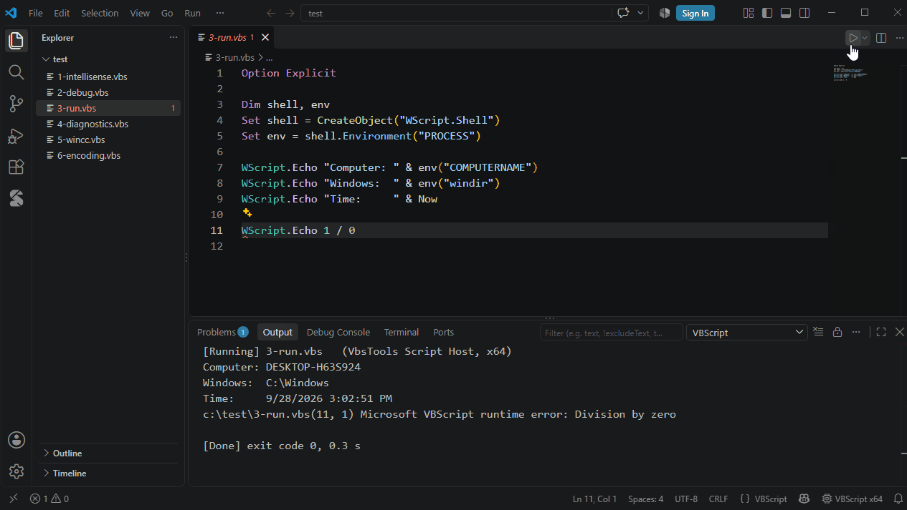

# Running scripts

| | |
|---|---|
| **Ctrl+F5** | Run the script |
| **Ctrl+Shift+F5** | Run with arguments (remembered per script) |
| **Shift+F5** | Stop |

- Output in the **VBScript** output panel; errors in the **Problems** panel, the cursor jumps to the line
- Scripts that read `WScript.StdIn` run in a terminal, so you can type
- **VBScript x64 / x86** in the status bar switches to 32-bit for COM components registered for 32-bit only
- Runs in the bundled **VbsTools Script Host** (behaves like cscript), or in cscript itself: setting `vbscript.run.host`
