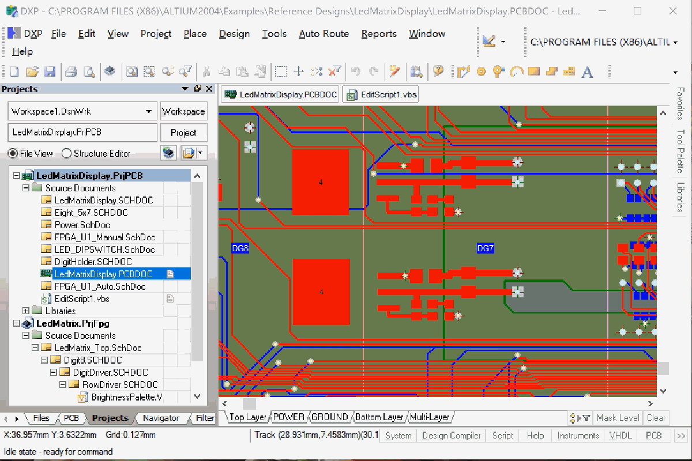

# 调试在其他软件内部运行的脚本



有些软件（例如 Altium DXP）自己运行 VBScript。VS Code 可以**附加**到它们并调试这些脚本——断点、单步、变量和调试控制台都能用。

**1. 一次性准备。** 执行 **VBScript: 检查附加调试环境**（左侧的链接）。它检查三项，其中两项可以直接帮你处理：

- **Process Debug Manager**（`pdm.dll`）——随 Visual Studio 或 Office 安装，本扩展不带
- **Machine Debug Manager**（`mdm.exe`）——选“注册这个 mdm.exe”，从你已安装的软件中选择带 Microsoft 签名的那个并注册（需要管理员权限）
- **Debugger Users** 用户组成员——选“把我加入该组……”即可；之后要**注销 Windows 再登录**一次

**也可以手动操作**——在**以管理员身份运行**的命令提示符中：

```bat
:: Machine Debug Manager：注册它（同时会安装名为 "MDM" 的 Windows 服务）。
:: 使用你已安装的 Visual Studio / Office 中带 Microsoft 签名的 mdm.exe，版本 7.0 或更高。
"C:\path\to\mdm.exe" /regserver

:: Debugger Users 用户组：如果电脑上没有就先创建，再把自己加进去。
net localgroup "Debugger Users" /add
net localgroup "Debugger Users" %USERNAME% /add
```

然后**注销 Windows 再登录**。`pdm.dll` 通常在 `C:\Program Files (x86)\Common Files\Microsoft Shared\VS7Debug`，这里不需要注册。撤销注册：`mdm.exe /unregserver`。检查：`sc query MDM`（应显示 RUNNING 或 STOPPED，而不是“不存在”）和 `net localgroup "Debugger Users"`（列表中有你的用户名）。

**2. 添加配置。** 打开 `launch.json`（第二个链接），加入：

```json
{ "type": "vbscript", "request": "attach", "name": "Attach to Altium DXP", "process": "DXP.exe" }
```

**3. 先附加，再运行。** 在完成准备**之后**启动软件，用这个配置按 **F5**，然后在软件中运行脚本。你设置的断点会在脚本启动时绑定。

- 附加不会让**已经在运行**的脚本停下：请使用之后才会执行到的断点，或点击暂停。
- Altium DXP 在脚本启动时会连接自己的调试器。如果附加时提示已有其他调试器，加上 `"takeOver": true`。
- 没有反应？到任务管理器里找**没有窗口**的 `DXP.exe`，结束它。
