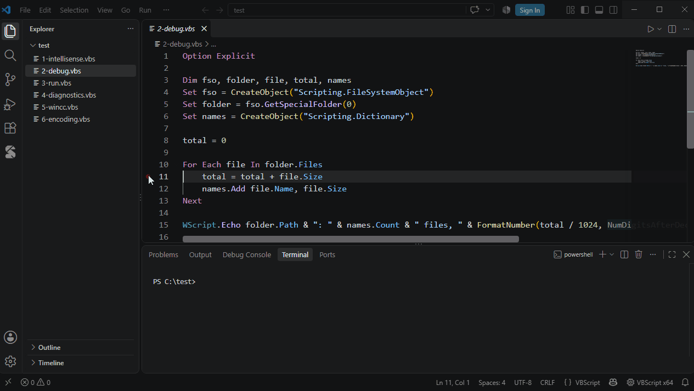

# 调试

| | |
|---|---|
| **F9** | 切换断点 |
| **F5** | 开始 / 继续 |
| **F10 / F11 / Shift+F11** | 单步跳过 / 进入 / 跳出 |
| **F6** | 暂停（在 `WScript.Sleep` 中也可以） |

- **变量**视图：局部变量和全局变量、数组、COM 对象、Dictionary，双击可修改值
- 暂停时，**监视**和鼠标悬停都能查看值
- **调试控制台**：`? 表达式` 求值，`x = 5` 赋值，支持自动补全
- 右键断点可以设置条件、命中次数或日志消息
- 不需要 `launch.json`
