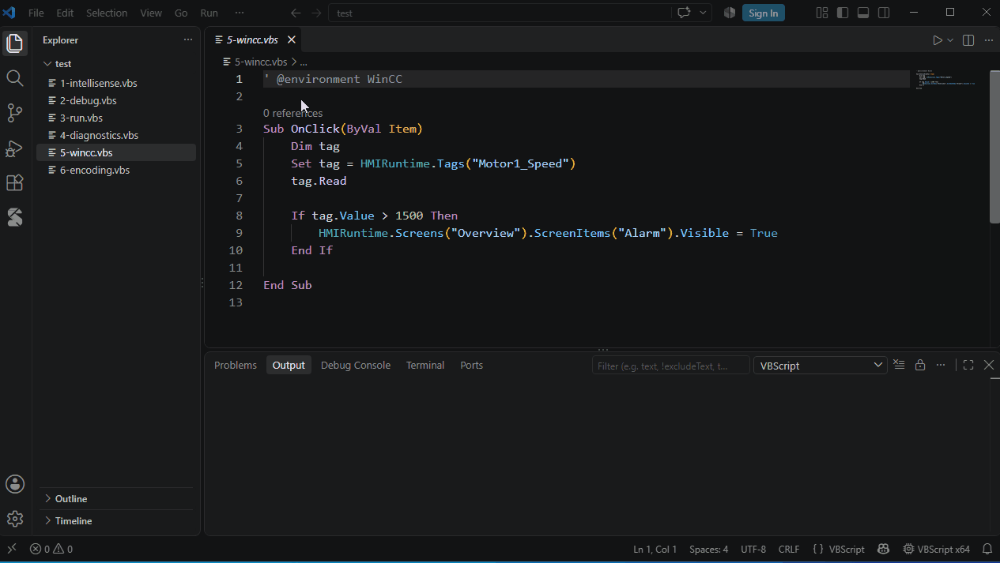

# 在软件内部运行的脚本



WinCC 等软件会给脚本提供自己的对象。启用 **WinCC** 环境后：

```vbscript
Sub OnClick(ByVal Item)
    Item.                                  ' 画面对象
    HMIRuntime.Tags("Motor1").Read
End Sub
```

对所有脚本启用：

```json
"vbscript.environments": ["WinCC"]
```

或在单个脚本中写注释 `' @environment WinCC`。

其他软件：在工作区中用 `*.vbstypes.json` 文件描述它们的对象。推断不出类型时，可以用注释说明：`' @type ws As Excel.Worksheet`。
