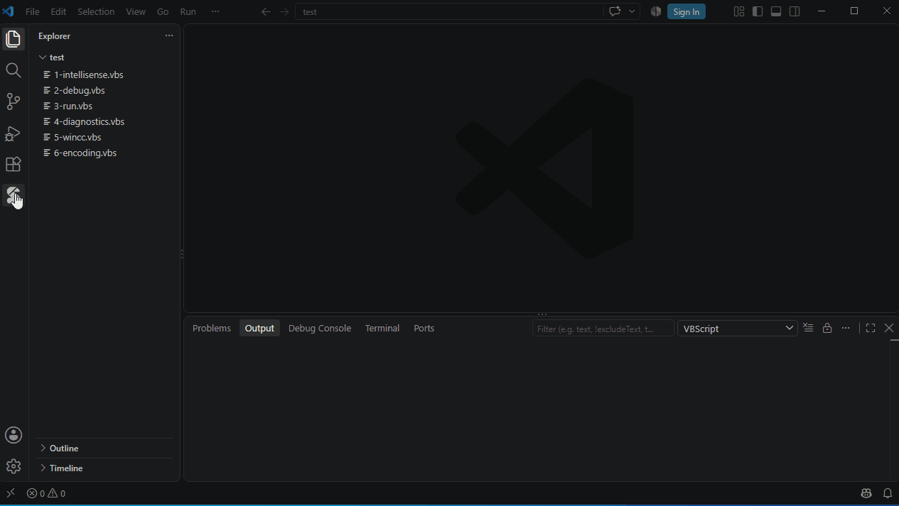

# 代码库

**示例**：安装了 VbsEdit 时显示 VbsEdit 的示例集，否则显示 VbsTools Studio 的示例

- 单击预览，**插入到光标处**，**以此新建脚本**
- 🔍 按名称和内容搜索

**我的代码片段**：自己的代码，每个都有快捷键

- 在脚本中输入快捷键，从补全列表中选择即可插入
- 选中代码，右键 → **添加到我的代码片段…**
- 在编辑器中修改代码片段，按 **Ctrl+S** 保存
- `${1:name}` 表示占位符
