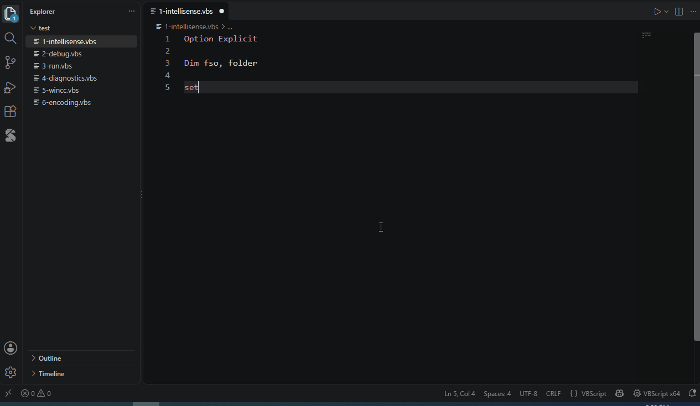

# COM 对象的智能提示



```vbscript
Set fso = CreateObject("Scripting.FileSystemObject")
fso.                               ' FileSystemObject 的成员
fso.GetFolder("C:\").Files.        ' 链式调用
For Each f In fso.GetFolder("C:\").Files
    f.                             ' For Each 的元素类型：File
Next
```

- 在 `CreateObject("` 中列出本机注册的 ProgID
- 输入 `(` 和 `,` 时显示参数，悬停显示说明
- 未声明的变量、不存在的过程、参数个数错误会显示警告，并可快速修复（**Ctrl+.**）
