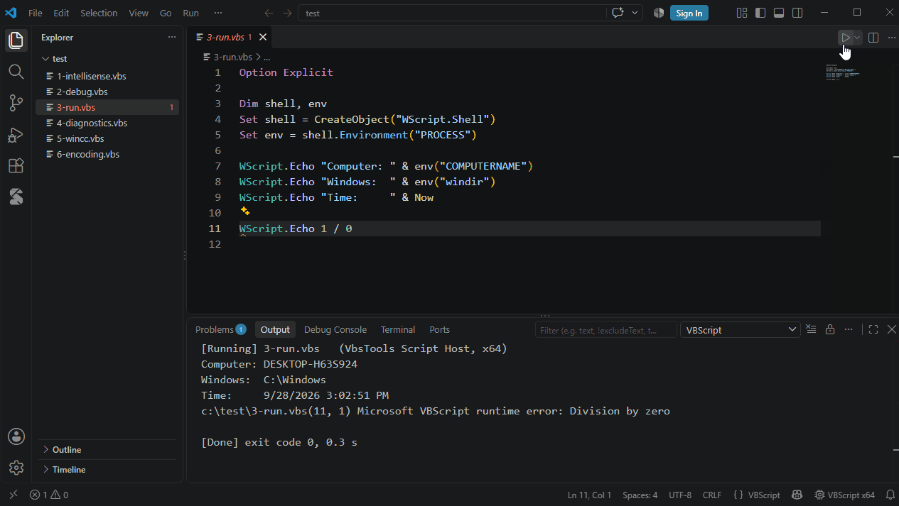

# 运行脚本

| | |
|---|---|
| **Ctrl+F5** | 运行脚本 |
| **Ctrl+Shift+F5** | 带参数运行（按脚本记住参数） |
| **Shift+F5** | 停止 |

- 输出显示在 **VBScript** 输出面板；错误显示在**问题**面板，光标跳到出错的行
- 读取 `WScript.StdIn` 的脚本会在终端中运行，可以输入
- 状态栏的 **VBScript x64 / x86** 可切换到 32 位，用于只注册了 32 位的 COM 组件
- 在自带的 **VbsTools 脚本宿主**（行为与 cscript 一致）中运行，也可以改用 cscript：设置 `vbscript.run.host`
